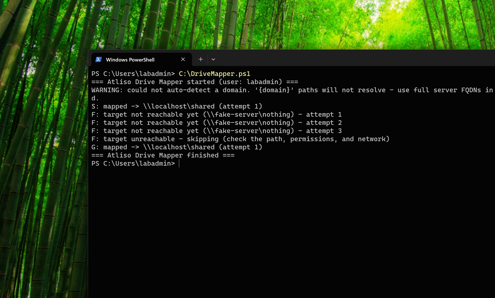
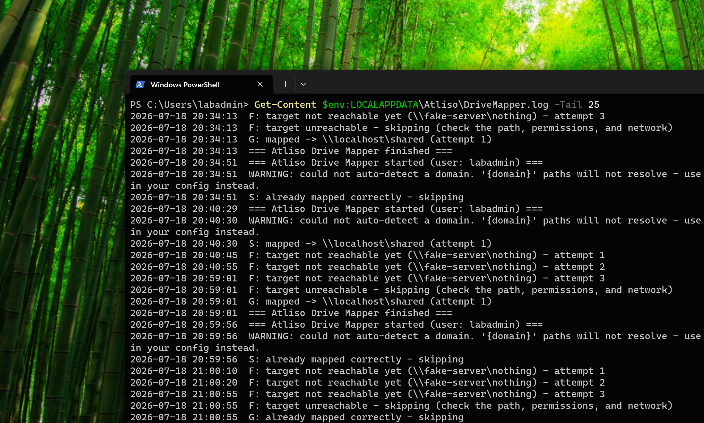

# Intune Drive Mapper

PowerShell script that maps network drives on Intune-managed Windows devices. No GPO required.

If you're moving device management from on-prem Group Policy to Intune, drive mappings are one of the first things to break. There's no native "Drive Maps" payload in Intune the way there is in Group Policy Preferences — so the standard answer is a PowerShell script deployed in user context.

This script is that answer. Edit one block, deploy via Intune, done.

## Features

- **One config block** — define drive letter, UNC path, label, and optional group filter
- **Auto-detects your AD DNS domain** — `{domain}` token resolves at runtime
- **AD group filtering** — reads the user's token directly (no LDAP queries, no RSAT, works over VPN)
- **Idempotent** — safe to re-run; fixes wrong mappings, skips correct ones
- **Safe replacement** — never removes a working drive in favour of an unreachable path
- **Retry with backoff** — retries 3 times (10s, 20s, 30s) to cover VPN still connecting at logon
- **Per-run logging** — every action timestamped in `%LOCALAPPDATA%\Atliso\DriveMapper.log`

## Quick start

1. Download [`Atliso-DriveMapper.ps1`](Atliso-DriveMapper.ps1)
2. Edit the `$DriveMappings` block at the top:

```powershell
$DriveMappings = @(
    @{ Letter = "S"; Path = "\\fileserver.{domain}\shared";              Label = "Shared" }
    @{ Letter = "H"; Path = "\\fileserver.{domain}\home\$env:USERNAME";  Label = "Home" }
    @{ Letter = "F"; Path = "\\fileserver.{domain}\finance";             Label = "Finance"; GroupFilter = "Finance-Team" }
)
```

3. Deploy via Intune (see below)

## Deploying in Intune

1. In the Intune admin center: **Devices > Scripts and remediations > Platform scripts** > Add > Windows 10 and later.
2. Upload `Atliso-DriveMapper.ps1`.
3. Three settings matter:
   - **Run this script using the logged on credentials: Yes.** Drives are per-user. Run as SYSTEM and the drives map into the SYSTEM profile — the logged-on user sees nothing.
   - **Enforce script signature check: No** (unless you sign your scripts).
   - **Run script in 64-bit PowerShell Host: Yes.**
4. Assign to a **user group**, not a device group.

Platform scripts run once per user per device (re-running when the script changes). If you want mappings re-checked on a schedule, deploy as a **Remediation** paired with a detection script instead.

## What it looks like



Three behaviours in one run:

- **S: and G: map immediately** — `New-PSDrive -Persist` writes a real Windows mapped drive that shows in File Explorer and survives reboots.
- **F: fails safely.** The target doesn't exist, so the script retries three times with increasing waits, then skips. No errors thrown, no drives harmed.
- **Group-filtered drives** only map when the user is a member of the required group.



Every run is timestamped in `%LOCALAPPDATA%\Atliso\DriveMapper.log` — the first place to look when a user reports a missing drive.

## Requirements

- **Network path to the file server** when the script runs (VPN up, or on the office network)
- **Hybrid-joined devices** get Kerberos transparently; **Entra-only devices** need cloud Kerberos trust for on-prem SMB access
- If devices are not domain-joined, use full FQDNs instead of the `{domain}` token
- The drive letter must be free (or already mapped to the correct path)
- Windows 10 / 11 with PowerShell 5.1+

## Verifying it worked

On the device, as the logged-on user:

```powershell
net use
Get-Content $env:LOCALAPPDATA\Atliso\DriveMapper.log -Tail 25
```

## License

[MIT](LICENSE) — free to use, modify, and distribute.

---

Built by [Atliso](https://atliso.com). Full walkthrough: [Deploying Drive Mappings via Intune Without GPO](https://atliso.com/blog/deploying-drive-mappings-via-intune). Get the tool: [Intune Drive Mapper](https://atliso.com/tools/intune-drive-mapper).
